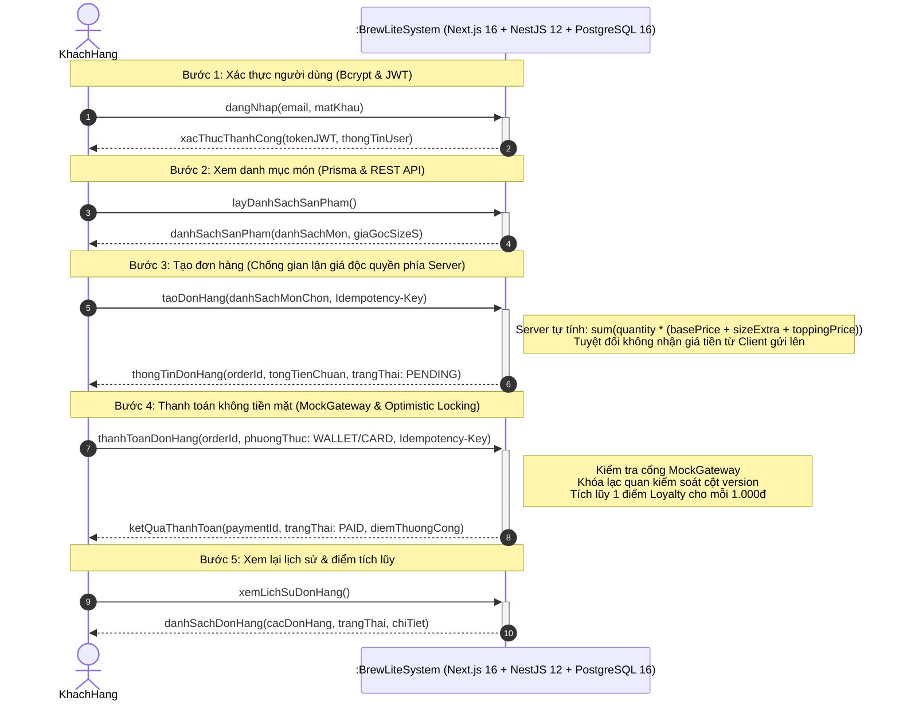
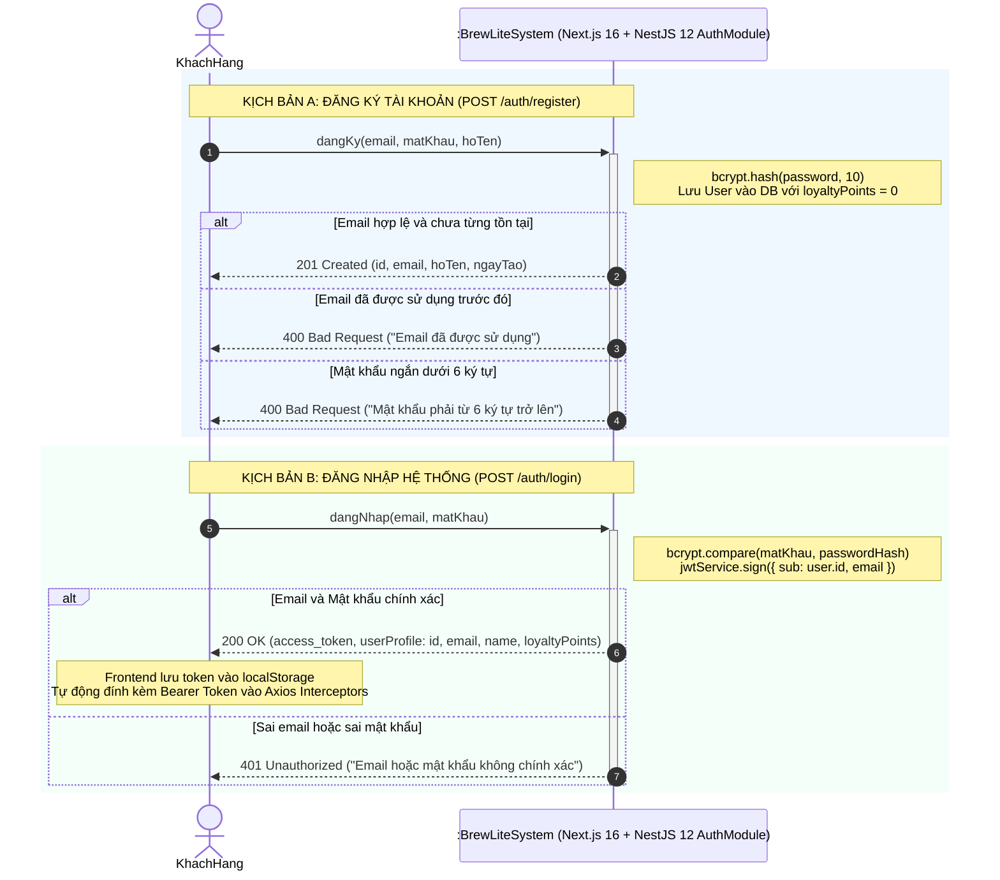
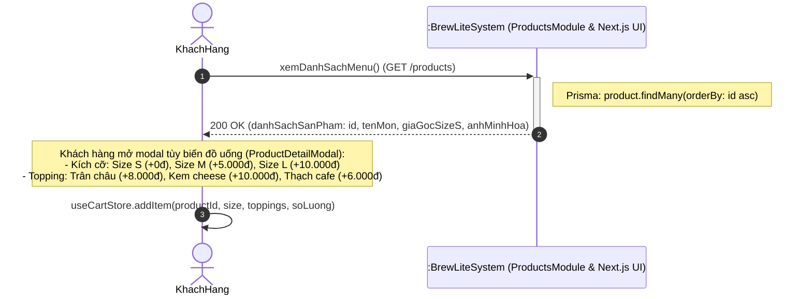
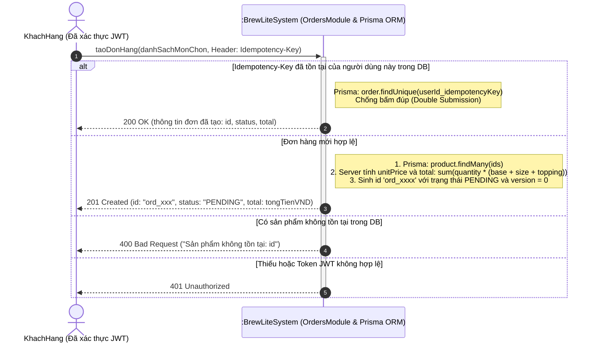
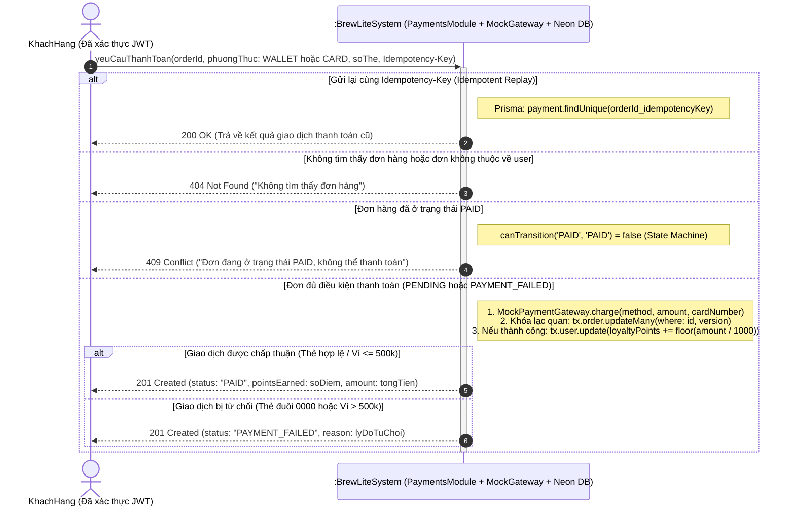
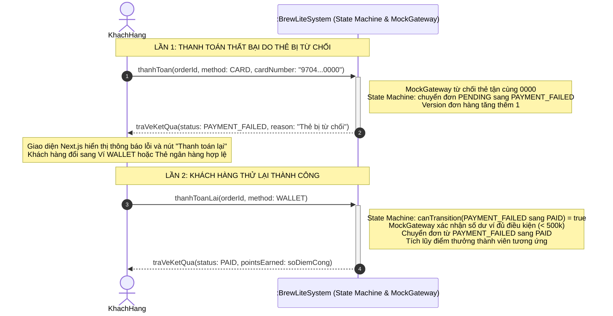
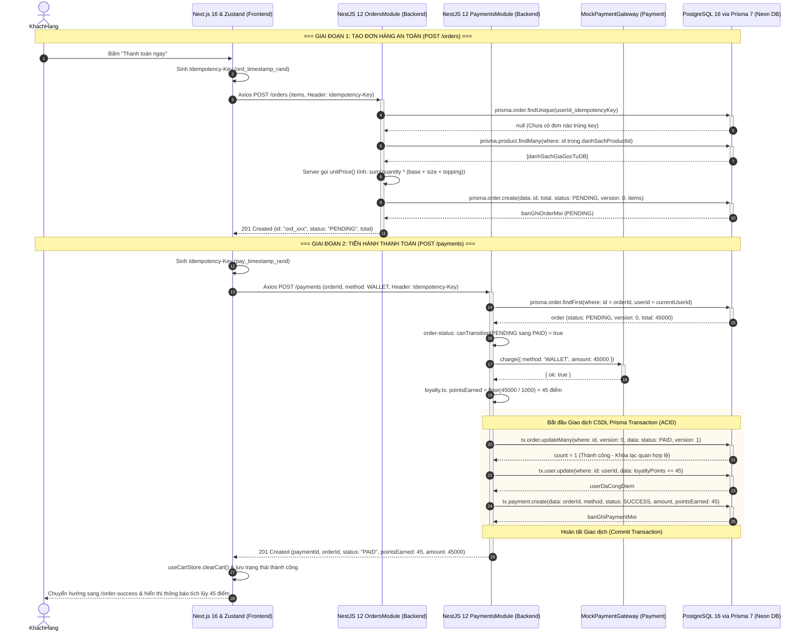

# 📊 SƠ ĐỒ TUẦN TỰ MỨC HỆ THỐNG (SYSTEM-LEVEL SEQUENCE DIAGRAM - SSD)
### ỨNG DỤNG ĐẶT CÀ PHÊ MỘC & THANH TOÁN KHÔNG TIỀN MẶT — BREWLITE
> **Môn học:** Công nghệ Phần mềm (Software Engineering) — Assignment 01 & 02  
> **Khoa Công nghệ Thông tin — Trường Đại học Sài Gòn (SGU)**  
> **Căn cứ thiết kế:** Toàn bộ kiến trúc và logic nghiệp vụ từ mã nguồn hiện hành (`backend/src` & `frontend/src`)

---

## 📑 MỤC LỤC
1. [Khái niệm & Nguyên tắc vẽ System-Level Sequence Diagram (SSD)](#1-khái-niệm--nguyên-tắc-vẽ-system-level-sequence-diagram-ssd)
2. [Bảng ma trận công nghệ sử dụng trong hệ thống (Full-Stack Tech Stack Matrix)](#2-bảng-ma-trận-công-nghệ-sử-dụng-trong-hệ-thống-full-stack-tech-stack-matrix)
3. [Sơ đồ 1: Tổng quan toàn trình nghiệp vụ hệ thống (End-to-End Black-box SSD)](#3-sơ-đồ-1-tổng-quan-toàn-trình-nghiệp-vụ-hệ-thống-end-to-end-black-box-ssd)
4. [Sơ đồ 2: Phân hệ Xác thực & Cấp phát JWT (Authentication SSD)](#4-sơ-đồ-2-phân-hệ-xác-thực--cấp-phát-jwt-authentication-ssd)
5. [Sơ đồ 3: Phân hệ Tra cứu Menu & Tùy biến món (Product Customization SSD)](#5-sơ-đồ-3-phân-hệ-tra-cứu-menu--tùy-biến-món-product-customization-ssd)
6. [Sơ đồ 4: Phân hệ Đặt hàng & Tính giá Server-Side (Order Creation SSD)](#6-sơ-đồ-4-phân-hệ-đặt-hàng--tính-giá-server-side-order-creation-ssd)
7. [Sơ đồ 5: Phân hệ Thanh toán, Khóa lạc quan & Tích điểm (Payment Processing SSD)](#7-sơ-đồ-5-phân-hệ-thanh-toán-khóa-lạc-quan--tích-điểm-payment-processing-ssd)
8. [Sơ đồ 6: Các kịch bản ngoại lệ & Phục hồi lỗi (Exception & Recovery SSD)](#8-sơ-đồ-6-các-kịch-bản-ngoại-lệ--phục-hồi-lỗi-exception--recovery-ssd)
9. [Sơ đồ 7: Kiến trúc phân tầng công nghệ chuyên sâu (Multi-Tier Architecture Sequence Diagram)](#9-sơ-đồ-7-kiến-trúc-phân-tầng-công-nghệ-chuyên-sâu-multi-tier-architecture-sequence-diagram)
10. [Bảng hợp đồng thao tác hệ thống (System Operations Contract)](#10-bảng-hợp-đồng-thao-tác-hệ-thống-system-operations-contract)
11. [Hướng dẫn biên dịch & xem trước Mermaid](#11-hướng-dẫn-biên-dịch--xem-trước-mermaid)

---

## 1. Khái niệm & Nguyên tắc vẽ System-Level Sequence Diagram (SSD)

Trong quy trình phát triển phần mềm chuẩn mực (Software Engineering / Unified Process theo giáo trình Craig Larman):
- **Sơ đồ tuần tự mức hệ thống (System Sequence Diagram - SSD)** mô tả các sự kiện nhập/xuất giữa **Tác nhân bên ngoài (Actor)** và **Hệ thống phần mềm (System)** cho từng kịch bản Use Case.
- Ở mức trừu tượng hóa phân tích (Analysis level), hệ thống được xem như một **Hộp đen (Black Box)** ký hiệu là `:System` hoặc `:BrewLiteSystem`.
- Ở mức thiết kế kiến trúc kỹ thuật (Architectural Design level), hệ thống được mở rộng thành **Sơ đồ tuần tự phân tầng công nghệ (Multi-Tier Technology Sequence Diagram)** nhằm thể hiện rõ vai trò của từng công nghệ trong việc xử lý gói tin và dữ liệu.

---

## 2. Bảng ma trận công nghệ sử dụng trong hệ thống (Full-Stack Tech Stack Matrix)

Toàn bộ hệ thống BrewLite được phát triển dựa trên các công nghệ chuẩn mực công nghiệp hiện hành:

| Phân Tầng | Công Nghệ Chính | Phiên Bản | Thư Viện / Cơ Chế Bổ Trợ | Vai Trò Kỹ Thuật Trong Chu Trình Sequence |
|:---|:---|:---:|:---|:---|
| **🌐 Frontend (Client)** | **Next.js** (App Router) | `16.4.2` | React 19, Turbopack | Dựng giao diện Web SSR/CSR, định tuyến trang (`/`, `/cart`, `/checkout`, `/orders`, `/order-success`). |
| **📦 State Management** | **Zustand** | `5.0.16` | `localStorage` Sync | Quản lý Giỏ hàng (`useCartStore`) và Trạng thái xác thực (`useAuthStore`) trên trình duyệt người dùng. |
| **🔌 HTTP Client** | **Axios** | `1.20.0` | Axios Interceptors | Tự động chèn Bearer Token vào header `Authorization`, sinh `Idempotency-Key`, bắt lỗi Rate Limit `429`. |
| **🎨 Giao diện & Icon** | **Tailwind CSS** + **Lucide** | `v4` / `1.61` | Mobile-first, Dark Mode | Hiển thị responsive trên thiết bị di động, tối ưu SVG icon đồ uống và trạng thái thanh toán. |
| **🚀 Backend API (Server)**| **NestJS** | `12.0.1` | TypeScript ESM (`"type": "module"`) | Dependency Injection, Module hóa kiến trúc: Auth, Products, Orders, Payments, Prisma. |
| **🔐 Bảo Mật & Xác Thực** | **JWT** + **Bcryptjs** | `@nestjs/jwt` `12.0.3`<br/>`bcryptjs 3.0.3` | `JwtAuthGuard`, `@CurrentUser()` | Băm mật khẩu (salt rounds = 10), cấp phát stateless access token, bảo vệ endpoint bằng Guard. |
| **🛡️ Chuẩn Hóa & Bền Vững**| **IETF Idempotency** | Chuẩn RFC | Regex validation, Unique Index | Chống trừ tiền và tạo đơn trùng lặp khi người dùng click liên tục hoặc mạng chập chờn. |
| **🔒 Kiểm Soát Đồng Thời** | **Optimistic Locking** | Thuật toán | Cột `version` trong bảng `Order` | Chặn xung đột cập nhật đồng thời, tự động trả về `409 Conflict` nếu phiên bản bản ghi bị lệch. |
| **🚦 Máy Trạng Thái Đơn** | **State Machine** | Module `order-status`| `canTransition()`, `assertTransition()` | Kiểm soát nghiêm ngặt: `PENDING → PAID` hoặc `PENDING → PAYMENT_FAILED → PAID`. |
| **💎 Tầng ORM** | **Prisma ORM** | `7.10.1` | `@prisma/adapter-pg` | Type-safe Database Client, tự động sinh Migration, thực thi `$transaction` ACID. |
| **🗄️ Cơ Sở Dữ Liệu** | **PostgreSQL** | `16` | Neon.tech Cloud Connection Pool | Lưu trữ quan hệ dữ liệu: `User`, `Product`, `Order`, `OrderItem`, `Payment`. |
| **💳 Cổng Thanh Toán** | **MockPaymentGateway** | In-memory Mock | Thuật toán kiểm tra thẻ / ví | Mô phỏng cổng thẻ (từ chối đuôi 0000) và ví điện tử (giới hạn 500.000đ). |
| **☁️ Môi Trường Đám Mây** | **Cloud Serverless** | 24/7 Live | Vercel (Front) + Render (API) + Neon (DB) | Triển khai phân tán toàn cầu, tự động tích hợp CI/CD qua GitHub Actions. |

---

## 3. Sơ đồ 1: Tổng quan toàn trình nghiệp vụ hệ thống (End-to-End Black-box SSD)

Sơ đồ thể hiện chu trình khép kín của khách hàng từ lúc đăng nhập, duyệt menu, đặt đơn hàng chống gian lận giá, thanh toán thẻ/ví đến khi nhận điểm thưởng thành viên.



---

## 4. Sơ đồ 2: Phân hệ Xác thực & Cấp phát JWT (Authentication SSD)

* **Frontend:** Next.js Modal, Axios Client, Zustand `useAuthStore`.
* **Backend:** `AuthController`, `AuthService`, `bcryptjs` (salt rounds = 10), `@nestjs/jwt`.
* **Database:** Bảng `User` trong PostgreSQL qua Prisma.



---

## 5. Sơ đồ 3: Phân hệ Tra cứu Menu & Tùy biến món (Product Customization SSD)

* **Frontend:** `ProductCard`, `ProductDetailModal` (Next.js 16 + Tailwind CSS), Zustand `useCartStore`.
* **Backend:** `ProductsController`, `ProductsService`.
* **Database:** Bảng `Product` (truy vấn sắp xếp theo `id ASC`).



---

## 6. Sơ đồ 4: Phân hệ Đặt hàng & Tính giá Server-Side (Order Creation SSD)

* **Frontend:** Trang Checkout, Axios Interceptor sinh `Idempotency-Key: ord_<timestamp>_<random>`.
* **Backend:** `OrdersController`, `OrdersService`, hàm tính giá `unitPrice()`.
* **Bảo mật:** Loại bỏ hoàn toàn trường giá tiền từ Client; kiểm tra bảng `Product` để lấy giá gốc và tính toán tổng tiền độc quyền ở Server.



---

## 7. Sơ đồ 5: Phân hệ Thanh toán, Khóa lạc quan & Tích điểm (Payment Processing SSD)

* **Frontend:** Giao diện thanh toán thẻ/ví, Axios gửi `Header: Idempotency-Key: pay_<timestamp>_<random>`.
* **Backend:** `PaymentsService`, `order-status.ts` (State Machine), `loyalty.ts` (Tích lũy điểm).
* **Gateway & DB:** `MockPaymentGateway`, Giao dịch phân tán ACID `prisma.$transaction` với Khóa lạc quan kiểm tra cột `version`.



---

## 8. Sơ đồ 6: Các kịch bản ngoại lệ & Phục hồi lỗi (Exception & Recovery SSD)

### 8.1. Kịch bản Thanh toán thất bại và Khách hàng thanh toán lại thành công (State Transition)



### 8.2. Kịch bản Xử lý Xung đột đồng thời (Optimistic Locking Concurrency 409)

```mermaid
sequenceDiagram
    autonumber
    actor ClientA as Khách hàng (Thiết bị A)
    actor ClientB as Khách hàng (Thiết bị B)
    participant System as :BrewLiteSystem (Prisma Optimistic Locking)

    Note over ClientA, ClientB: Cả hai thiết bị cùng gửi yêu cầu thanh toán cho Đơn hàng (Phiên bản ban đầu: version = 0)
    ClientA->>+System: thanhToan(orderId, method: WALLET)
    ClientB->>+System: thanhToan(orderId, method: CARD)

    Note right of System: Giao dịch A cập nhật CSDL trước:<br/>UPDATE "Order" SET status = 'PAID', version = 1<br/>WHERE id = orderId AND version = 0;<br/>-> Cập nhật thành công 1 bản ghi!
    System-->>-ClientA: 200 OK (Thanh toán thành công, Trạng thái đơn: PAID)

    Note right of System: Giao dịch B thực thi sau:<br/>UPDATE "Order" SET status = 'PAID', version = 1<br/>WHERE id = orderId AND version = 0;<br/>-> count = 0 (Vì version hiện tại trong DB đã là 1)!
    System-->>-ClientB: 409 Conflict ("Đơn vừa được cập nhật bởi yêu cầu khác, vui lòng thử lại")
```

---

## 9. Sơ đồ 7: Kiến trúc phân tầng công nghệ chuyên sâu (Multi-Tier Architecture Sequence Diagram)

Sơ đồ thể hiện luồng nghiệp vụ tương tác thực tế giữa từng công nghệ trong kiến trúc phần mềm:
- **Tầng Giao diện (Presentation Layer):** Next.js 16 (App Router, Turbopack) + Zustand State Store + Axios Client.
- **Tầng Điều khiển & Nghiệp vụ (Application Layer):** NestJS 12 Modules (Auth, Products, Orders, Payments) chạy trên TypeScript ESM.
- **Tầng Tích hợp Dịch vụ Ngoài (Integration Layer):** MockPaymentGateway.
- **Tầng Dữ liệu (Persistence Layer):** PostgreSQL 16 (Neon Cloud) tương tác qua Prisma 7 ORM (`@prisma/adapter-pg`).



---

## 10. Bảng hợp đồng thao tác hệ thống (System Operations Contract)

| Thao tác hệ thống (Operation) | Công nghệ đảm nhiệm | Endpoint HTTP & Headers | Tham số đầu vào (Parameters) | Hậu điều kiện (Postconditions) | Mã lỗi ngoại lệ |
|:---|:---|:---|:---|:---|:---|
| **`dangKy`** | Next.js + NestJS + `bcryptjs` + Prisma | `POST /auth/register` | `email`, `password`, `name` | Bản ghi `User` mới được tạo trong CSDL PostgreSQL, mật khẩu băm bcrypt, `loyaltyPoints = 0` | `400 Bad Request` |
| **`dangNhap`** | Next.js + NestJS + `@nestjs/jwt` | `POST /auth/login` | `email`, `password` | Cấp phát stateless JWT Bearer Token chứa thông tin định danh `sub: user.id` | `401 Unauthorized` |
| **`layDanhSachMenu`** | Next.js + NestJS + Prisma ORM | `GET /products` | Không có | Trả về mảng danh mục món sắp xếp theo `id ASC` gồm giá gốc size S | `500 Internal Error` |
| **`taoDonHang`** | Zustand + Axios + NestJS + Prisma | `POST /orders`<br/>`Header: Idempotency-Key` | `items: [{productId, size, toppings, quantity}]` | Tạo đơn hàng mới trạng thái `PENDING`, `version = 0`, tổng tiền tính độc quyền theo DB | `400 Bad Request`<br/>`401 Unauthorized` |
| **`thanhToanDonHang`** | Next.js + NestJS + MockGateway + Neon DB | `POST /payments`<br/>`Header: Idempotency-Key` | `orderId`, `method`, `cardNumber?` | Đơn chuyển sang `PAID`, `version = version + 1`, tích 1 điểm/1.000đ trong transaction ACID | `404 Not Found`<br/>`409 Conflict`<br/>`429 Too Many Req` |
| **`xemLichSuDon`** | Next.js + Axios + NestJS + Prisma | `GET /orders/me` | Không có | Trả về toàn bộ danh sách đơn của user sắp xếp theo `createdAt DESC` | `401 Unauthorized` |

---

## 11. Hướng dẫn biên dịch & xem trước Mermaid

Tài liệu này được định dạng hoàn toàn theo chuẩn **GitHub Flavored Markdown (GFM)** chứa các khối mã ````mermaid`. Quý Thầy/Cô và bạn đọc có thể xem và xuất sơ đồ qua các cách sau:

1. **Xem trực tiếp trên GitHub / GitLab / VS Code:**
   - Mở file `.md` trong VS Code và nhấn tổ hợp phím `Ctrl + Shift + V` (Markdown Preview).
   - Đảm bảo đã cài đặt extension **Markdown Preview Mermaid Support** hoặc sử dụng trực tiếp tính năng render tự động có sẵn của GitHub khi xem trên Repository.

2. **Chỉnh sửa & Xuất ảnh chất lượng cao (SVG / PNG):**
   - Sao chép bất kỳ khối mã nào trong cặp thẻ ````mermaid` và dán vào trình soạn thảo trực tuyến chính thức:  
     👉 [https://mermaid.live](https://mermaid.live)
   - Chọn định dạng tải về **Download SVG** (để chèn vào báo cáo LaTeX/Word mà không bị vỡ nét) hoặc **Download PNG**.

3. **Biên dịch hàng loạt sang PDF/HTML bằng CLI (Command Line):**
   ```bash
   # Cài đặt Mermaid CLI thông qua npm
   npm install -g @mermaid-js/mermaid-cli

   # Xuất file markdown sang PDF / HTML kèm sơ đồ đã render
   npx @mermaid-js/mermaid-cli -i docs/SYSTEM_LEVEL_SEQUENCE_DIAGRAM.md -o docs/SYSTEM_LEVEL_SEQUENCE_DIAGRAM.pdf
   ```
