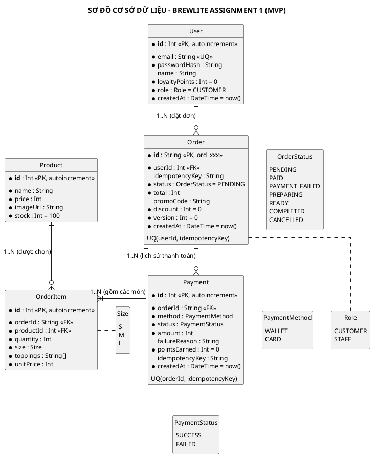
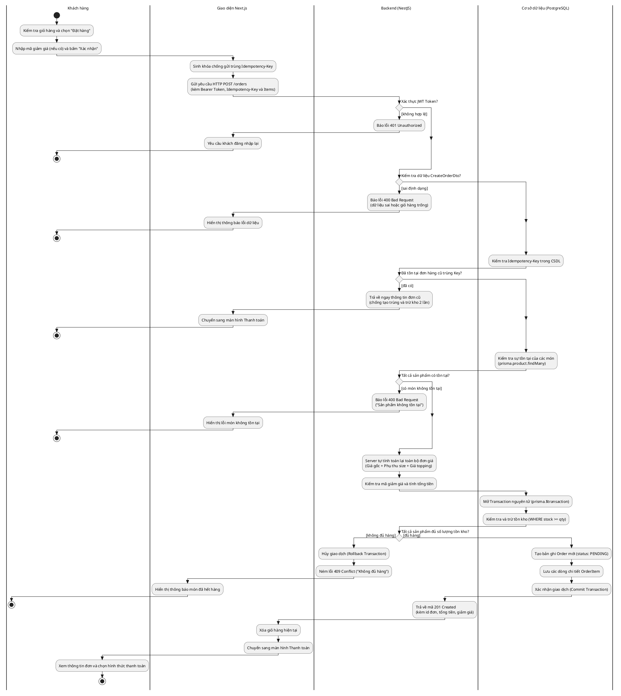
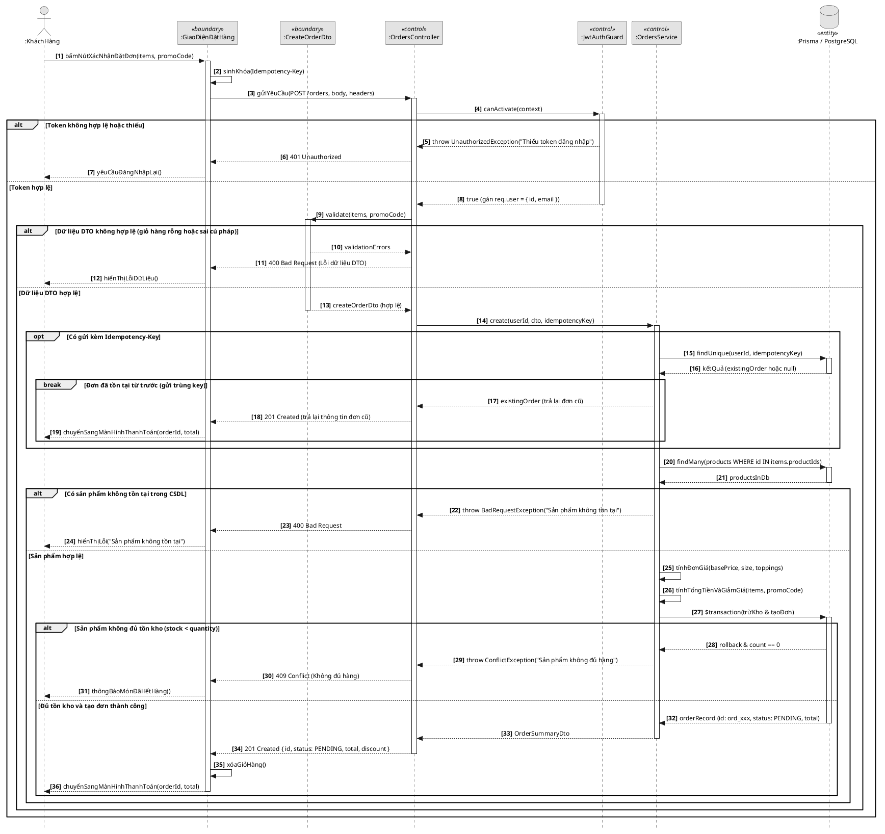
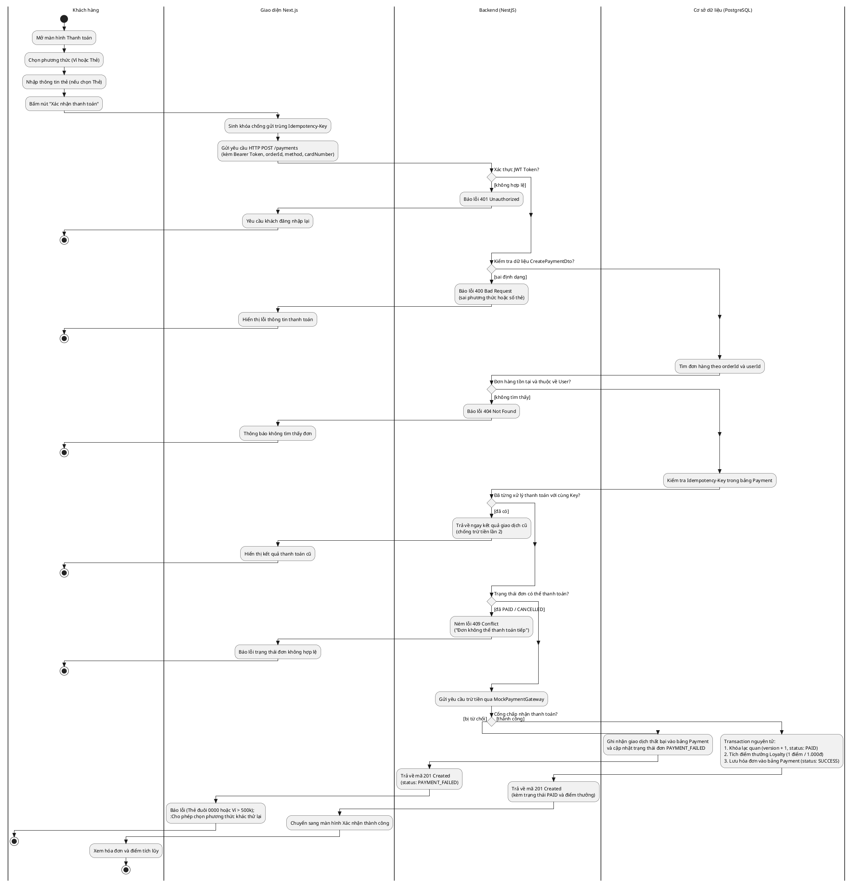
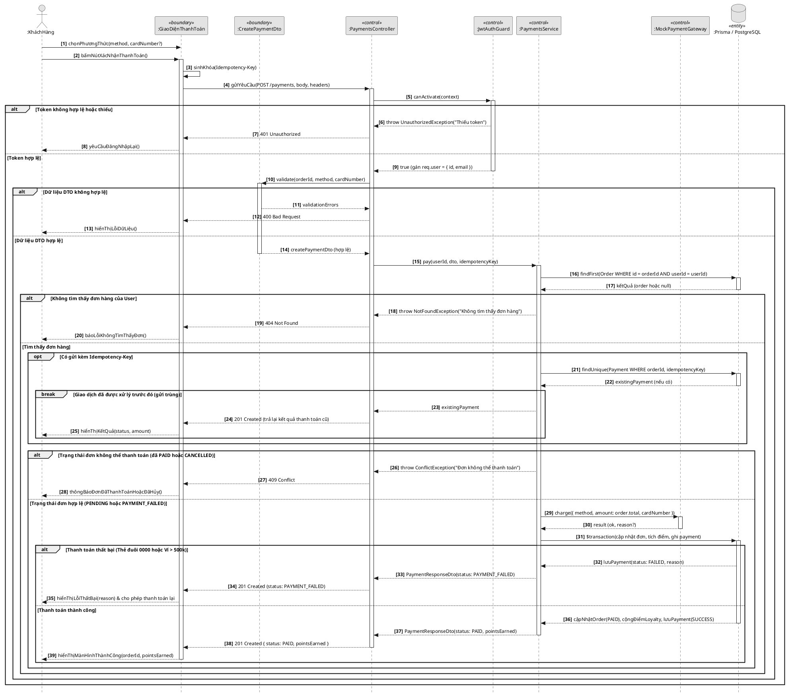
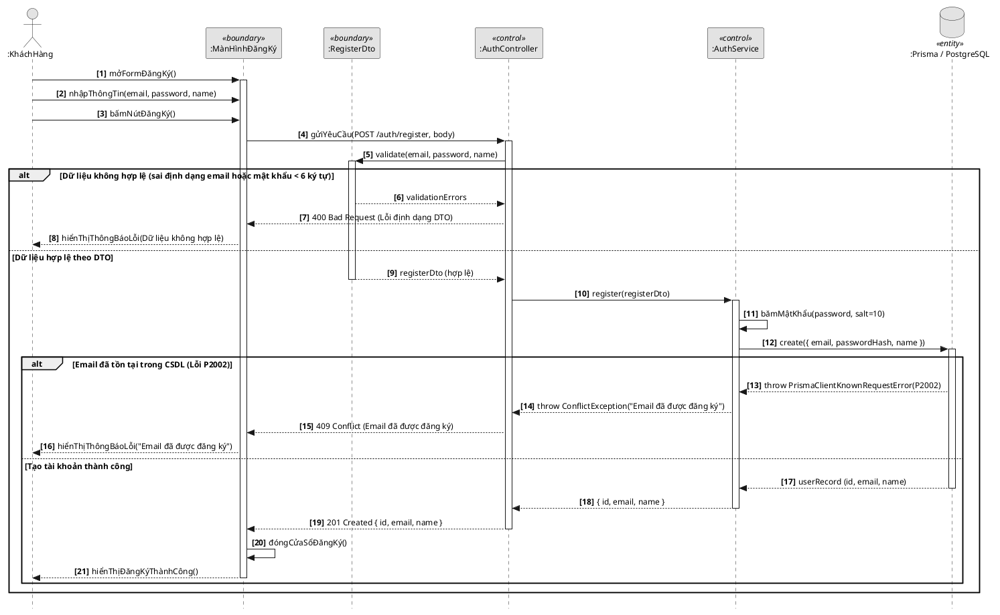
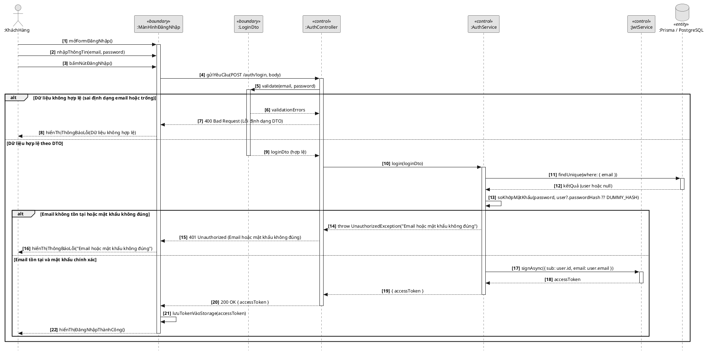
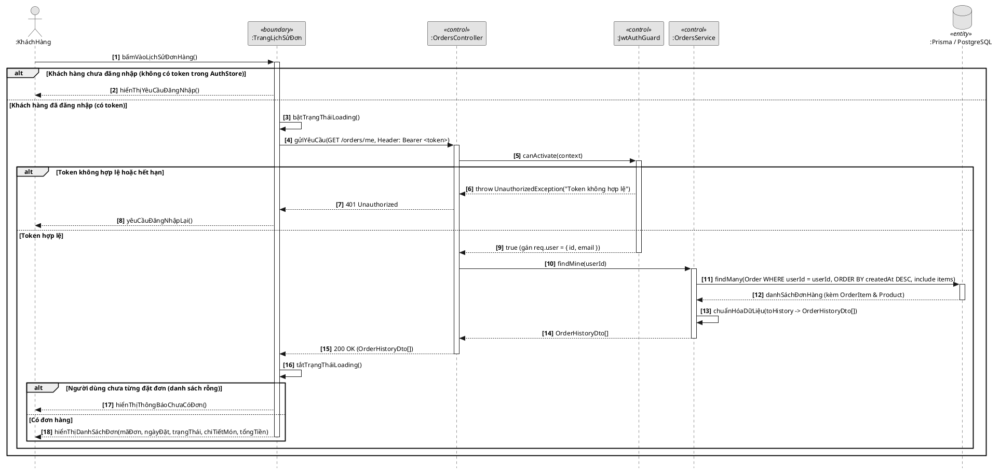

# HỆ THỐNG SƠ ĐỒ THIẾT KẾ & PHÂN TÍCH HỆ THỐNG (BREWLITE ASSIGNMENT 1 - MVP)

> **Dự án:** BrewLite - Ứng dụng Đặt cà phê không dùng tiền mặt (Assignment 1 - MVP)  
> **Ngôn ngữ mô hình hóa:** PlantUML chuẩn UML 2.5  
> **Quy ước:** File `.puml` là nguồn sự thật, xuất tự động ra `.png` và `.svg`.

---

## 📑 BẢNG TỔNG HỢP TOÀN BỘ SƠ ĐỒ THEO PHÂN HỆ

| Phân Hệ | Loại Sơ Đồ | Tên Sơ Đồ | File Nguồn PlantUML | Hình Ảnh PNG |
|:---:|:---:|---|:---:|:---:|
| **CSDL & Thực Thể** | **ERD** | Mô hình quan hệ Cơ sở dữ liệu | [`database-erd.puml`](./database/database-erd.puml) | [Xem ảnh](./database/database-erd.png) |
| **Sản Phẩm & Menu** | **Activity** | Luồng xem danh sách thực đơn | [`products-activity.puml`](./products/products-activity.puml) | [Xem ảnh](./products/products-activity.png) |
| **Sản Phẩm & Menu** | **Sequence** | Tuần tự gọi API `GET /products` | [`products-sequence.puml`](./products/products-sequence.puml) | [Xem ảnh](./products/products-sequence.png) |
| **Xác Thực (Auth)** | **Activity** | Luồng Đăng ký tài khoản mới | [`register-activity.puml`](./register/register-activity.puml) | [Xem ảnh](./register/register-activity.png) |
| **Xác Thực (Auth)** | **Sequence** | Tuần tự gọi API `POST /auth/register` | [`register-sequence.puml`](./register/register-sequence.puml) | [Xem ảnh](./register/register-sequence.png) |
| **Xác Thực (Auth)** | **Activity** | Luồng Đăng nhập lấy JWT | [`login-activity.puml`](./login/login-activity.puml) | [Xem ảnh](./login/login-activity.png) |
| **Xác Thực (Auth)** | **Sequence** | Tuần tự gọi API `POST /auth/login` | [`login-sequence.puml`](./login/login-sequence.puml) | [Xem ảnh](./login/login-sequence.png) |
| **Đặt Đơn Hàng** | **Activity** | Luồng tạo đơn hàng mới | [`orders-activity.puml`](./orders/orders-activity.puml) | [Xem ảnh](./orders/orders-activity.png) |
| **Đặt Đơn Hàng** | **Sequence** | Tuần tự tính giá & `POST /orders` | [`orders-sequence.puml`](./orders/orders-sequence.puml) | [Xem ảnh](./orders/orders-sequence.png) |
| **Thanh Toán (Payments)** | **Activity** | Luồng thanh toán thẻ / ví | [`payments-activity.puml`](./payments/payments-activity.puml) | [Xem ảnh](./payments/payments-activity.png) |
| **Thanh Toán (Payments)** | **Sequence** | Tuần tự `POST /payments` & tích điểm | [`payments-sequence.puml`](./payments/payments-sequence.puml) | [Xem ảnh](./payments/payments-sequence.png) |
| **Lịch Sử Đơn Hàng** | **Activity** | Luồng xem lịch sử đơn của khách | [`order-history-activity.puml`](./order-history/order-history-activity.puml) | [Xem ảnh](./order-history/order-history-activity.png) |
| **Lịch Sử Đơn Hàng** | **Sequence** | Tuần tự gọi API `GET /orders/me` | [`order-history-sequence.puml`](./order-history/order-history-sequence.puml) | [Xem ảnh](./order-history/order-history-sequence.png) |

---

## 1. Sơ Đồ Quan Hệ Cơ Sở Dữ Liệu (Database ERD)
Mô hình hóa các thực thể cốt lõi trong Assignment 1: `User`, `Category`, `Product`, `Order`, `OrderItem`, `Payment`:

---

## 2. Luồng Đặt Hàng & Tính Giá Server-Side (Orders Flow)
Khách hàng chọn món, kích thước (S/M/L) và topping. Server nhận payload, tính toán giá theo bảng giá chuẩn và tạo đơn hàng ở trạng thái `PENDING`:

### Sơ đồ Hoạt động (Activity Diagram):

### Sơ đồ Tuần tự (Sequence Diagram):

---

## 3. Luồng Thanh Toán Mô Phỏng & Tích Điểm (Payments Flow)
Xử lý giao dịch qua cổng thanh toán mô phỏng (Thẻ / Ví điện tử), kiểm soát lỗi thẻ bị từ chối (`0000`), cập nhật trạng thái sang `PAID` và tích điểm thưởng 1 điểm / 1.000đ:

### Sơ đồ Hoạt động (Activity Diagram):

### Sơ đồ Tuần tự (Sequence Diagram):

---

## 4. Luồng Xác Thực Khách Hàng (Authentication Flows)

### Đăng ký tài khoản (Register):

### Đăng nhập cấp mã truy cập JWT (Login):

---

## 5. Luồng Lịch Sử Đơn Hàng (Order History Flow)
Truy vấn danh sách đơn hàng của khách hàng đang đăng nhập thông qua mã JWT Bearer Token:

